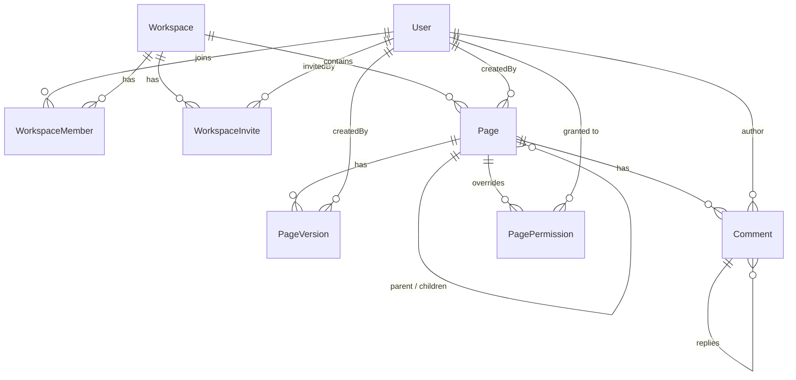

# Collab Workspace — API & Database Documentation

Real-time collaborative workspace (Notion-style pages, live cursors, comments, version history).

> **Scope.** This document describes the **active stack** (README Phases 1–8):
> `apps/web` (React + Vite) · `apps/server` (Express 5 REST API) · `websocket-server` (Yjs WebSocket) · PostgreSQL 16 · Redis 7.
> The older Next.js app in the repo root (`src/app/api/*`, `prisma/schema.prisma`) is a **legacy prototype** with a different schema and API; it is summarised in [Appendix A](#appendix-a--legacy-nextjs-app-root-srcappapi).

See `architecture-diagram.png` for the component view.

---

## Table of contents

1. [Services & ports](#1-services--ports)
2. [Authentication](#2-authentication)
3. [Authorization model](#3-authorization-model)
4. [Conventions: errors, limits, validation](#4-conventions-errors-limits-validation)
5. [REST API reference](#5-rest-api-reference)
6. [Real-time protocol (WebSocket + Redis)](#6-real-time-protocol-websocket--redis)
7. [Database schema](#7-database-schema)
8. [Environment variables](#8-environment-variables)
9. [Running locally](#9-running-locally)
10. [Implementation notes & observations](#10-implementation-notes--observations)
- [Appendix A — Legacy Next.js app](#appendix-a--legacy-nextjs-app-root-srcappapi)

---

## 1. Services & ports

| Service | Tech | Default address | Source |
|---|---|---|---|
| Web app | React 18, Vite, TipTap, Yjs | `http://localhost:5173` | `apps/web` |
| REST API | Express 5, Prisma, zod, helmet | `http://localhost:4000` | `apps/server/src/index.ts` |
| WebSocket server | `ws` + `y-websocket`, Prisma, ioredis | `ws://localhost:1234` | `websocket-server/server.mjs` |
| PostgreSQL | postgres:16-alpine | `localhost:5432` (`5433` in `.env.example`) | `docker-compose.yml` |
| Redis | redis:7-alpine (AOF on) | `localhost:6379` | `docker-compose.yml` |
| SMTP (optional) | nodemailer | configured via env | `apps/server/src/index.ts` |

Shared validation schemas and role helpers live in `packages/shared/src/index.ts` (zod).

---

## 2. Authentication

Cookie-based, stateless JWT (no session table).

| Property | Value |
|---|---|
| Cookie name | `collab_session` |
| Token | HS256 JWT, payload `{ sub: <userId>, exp }` |
| Lifetime | 7 days (`Max-Age=604800`) |
| Cookie flags | `HttpOnly; Path=/; SameSite=Lax` (+ `Secure` when `NODE_ENV=production`) |
| Signing secret | `JWT_SECRET` (falls back to `SESSION_SECRET`), min 32 chars |
| Password hashing | bcrypt, cost 12 |
| Password policy | 12–128 characters |

The **same cookie and secret** authenticate the WebSocket server, so both services must share the secret.

Browser clients must send `credentials: "include"`. CORS allows only `CORS_ORIGIN` (default `http://localhost:5173`) with methods `GET, POST, PATCH, DELETE, OPTIONS` (note: `PUT` is **not** in the CORS allow-list — see [§10](#10-implementation-notes--observations)).

**Auth levels used below:** 🔓 public · 🔐 signed-in · 🏢 workspace role required · 📄 page role required.

---

## 3. Authorization model

### 3.1 Workspace roles (`WorkspaceRole`)

| Capability | OWNER | ADMIN | MEMBER | VIEWER |
|---|:-:|:-:|:-:|:-:|
| Read workspace, pages, members | ✅ | ✅ | ✅ | ✅ |
| Create / rename / move / delete pages | ✅ | ✅ | ✅ | ❌ |
| Rename workspace, invite/remove members, manage page access | ✅ | ✅ | ❌ | ❌ |
| Remove another ADMIN | ✅ | ❌ | ❌ | ❌ |
| Delete workspace | ✅ | ❌ | ❌ | ❌ |

Helpers: `workspaceRoleCanManage` = OWNER/ADMIN; `workspaceRoleCanEdit` = anyone except VIEWER.

### 3.2 Page roles (`PageRole`)

The **effective page role** of a user is:

```
explicit PagePermission row  →  that role
otherwise (workspace role = VIEWER) → VIEW
otherwise                           → EDIT
```

| Capability | VIEW | COMMENT | EDIT |
|---|:-:|:-:|:-:|
| Read page, comments, versions | ✅ | ✅ | ✅ |
| Post comments / replies | ❌ | ✅ | ✅ |
| Resolve / reopen threads | ❌ | ❌ | ✅ |
| Save / restore versions | ❌ | ❌ | ✅ |
| Write to the live Yjs document | ❌ | ❌ | ✅ |

Non-members receive **404** (not 403) for workspaces and pages, so IDs are not revealed.

---

## 4. Conventions: errors, limits, validation

**Base URL:** `http://localhost:4000` · **Content-Type:** `application/json` · **Body limit:** 32 kB.

### Error format

```json
{ "error": "Human-readable message." }
```

Validation errors (zod) return **400**:

```json
{
  "error": "Invalid request.",
  "details": [{ "path": "password", "message": "String must contain at least 12 character(s)" }]
}
```

| Status | Meaning |
|---|---|
| 400 | Validation failed / invalid operation |
| 401 | Not signed in, or bad credentials |
| 403 | Signed in but lacks permission |
| 404 | Not found, or not a member (hidden) |
| 409 | Duplicate (email already registered) |
| 410 | Invitation expired / already used |
| 413 | Version snapshot too large |
| 429 | Rate limit exceeded |
| 500 | Unexpected error (generic message) |

### Rate limiting

`POST /api/auth/register`, `POST /api/auth/login`, `PATCH /api/auth/account` → **20 requests / 15 min** per client (`RateLimit` draft-7 headers).

### Strict schemas

All request bodies use `.strict()`: **unknown fields are rejected** with 400.

### Security headers

`helmet()` defaults; `X-Powered-By` disabled.

---

## 5. REST API reference

### 5.1 Endpoint summary

| # | Method | Path | Auth | Purpose |
|---|---|---|---|---|
| 1 | GET | `/api/health` | 🔓 | Liveness check |
| 2 | POST | `/api/auth/register` | 🔓 | Create account (optionally via invite) |
| 3 | POST | `/api/auth/login` | 🔓 | Sign in |
| 4 | POST | `/api/auth/logout` | 🔓 | Sign out (clears cookie) |
| 5 | GET | `/api/auth/me` | 🔐 | Current user |
| 6 | PATCH | `/api/auth/profile` | 🔐 | Update name / avatar / cursor colour |
| 7 | PATCH | `/api/auth/account` | 🔐 | Change email / password |
| 8 | GET | `/api/workspaces` | 🔐 | List my workspaces (with pages & members) |
| 9 | POST | `/api/workspaces` | 🔐 | Create workspace |
| 10 | PATCH | `/api/workspaces/:workspaceId` | 🏢 OWNER/ADMIN | Rename workspace |
| 11 | DELETE | `/api/workspaces/:workspaceId` | 🏢 OWNER | Delete workspace |
| 12 | POST | `/api/workspaces/:workspaceId/members` | 🏢 OWNER/ADMIN | Add existing user as member |
| 13 | DELETE | `/api/workspaces/:workspaceId/members/:memberId` | 🏢 OWNER/ADMIN | Remove member |
| 14 | GET | `/api/workspaces/:workspaceId/invites` | 🏢 OWNER/ADMIN | List pending invites |
| 15 | POST | `/api/workspaces/:workspaceId/invites` | 🏢 OWNER/ADMIN | Invite by email |
| 16 | DELETE | `/api/workspaces/:workspaceId/invites/:inviteId` | 🏢 OWNER/ADMIN | Revoke invite |
| 17 | GET | `/api/invites/:token` | 🔓 | Preview an invitation |
| 18 | POST | `/api/invites/:token/accept` | 🔐 | Accept an invitation |
| 19 | GET | `/api/workspaces/:workspaceId/pages` | 🏢 member | List pages |
| 20 | POST | `/api/workspaces/:workspaceId/pages` | 🏢 non-viewer | Create page |
| 21 | PATCH | `/api/pages/:pageId` | 🏢 non-viewer | Rename / move page |
| 22 | DELETE | `/api/pages/:pageId` | 🏢 non-viewer | Delete page |
| 23 | GET | `/api/pages/:pageId/permissions` | 📄 any | List per-user page access |
| 24 | PUT | `/api/pages/:pageId/permissions/:userId` | 🏢 OWNER/ADMIN | Set page role for a user |
| 25 | DELETE | `/api/pages/:pageId/permissions/:userId` | 🏢 OWNER/ADMIN | Reset to inherited role |
| 26 | GET | `/api/pages/:pageId/comments` | 📄 any | List comment threads |
| 27 | POST | `/api/pages/:pageId/comments` | 📄 COMMENT+ | Create thread / reply |
| 28 | PATCH | `/api/pages/:pageId/comments/:threadId` | 📄 EDIT | Resolve / reopen thread |
| 29 | GET | `/api/pages/:pageId/versions` | 📄 any | List versions (latest 50) |
| 30 | POST | `/api/pages/:pageId/versions` | 📄 EDIT | Save a version |
| 31 | GET | `/api/pages/:pageId/versions/:versionId` | 📄 any | Get version snapshot |
| 32 | POST | `/api/pages/:pageId/versions/:versionId/restore` | 📄 EDIT | Fetch snapshot for restore |

Shared object shapes used in responses:

```ts
SafeUser   = { id: string; name: string; email: string; avatarUrl: string | null; cursorColor?: string }
Role       = "OWNER" | "ADMIN" | "MEMBER" | "VIEWER"          // workspace
PageRole   = "VIEW" | "COMMENT" | "EDIT"
```

---

### 5.2 Health

#### `GET /api/health`
```json
200  { "status": "ok" }
```

---

### 5.3 Auth

#### `POST /api/auth/register`  🔓 (rate-limited)

| Field | Type | Rules |
|---|---|---|
| `name` | string | trimmed, 1–80 |
| `email` | string | valid email, ≤254, lower-cased |
| `password` | string | 12–128 chars |
| `inviteToken` | string? | 64 hex chars |

- **Without** `inviteToken`: creates the user, a private workspace `"<name>'s workspace"` (user = OWNER) and a `"Welcome"` page — all in one transaction.
- **With** `inviteToken`: the email must match the invite; the invite is claimed atomically and the user joins that workspace with the invited role (no private workspace is created).
- Sets the `collab_session` cookie.

```bash
curl -i -X POST http://localhost:4000/api/auth/register \
  -H "Content-Type: application/json" \
  -d '{"name":"Avni","email":"avni@example.com","password":"a-long-password-123"}'
```
```json
201  { "user": { "id": "clx…", "name": "Avni", "email": "avni@example.com", "avatarUrl": null } }
```
Errors: `400` validation · `403` invite was sent to a different email · `404` invite invalid/used · `409` email already exists · `410` invite expired · `429`.

#### `POST /api/auth/login`  🔓 (rate-limited)
Body: `{ "email": string, "password": string }` (password 1–128).
```json
200  { "user": SafeUser }      // + Set-Cookie: collab_session
401  { "error": "Email or password is incorrect." }
```

#### `POST /api/auth/logout`  🔓
Clears the cookie. `204 No Content`.

#### `GET /api/auth/me`  🔐
```json
200  { "user": { "id", "name", "email", "avatarUrl", "cursorColor" } }
401  { "error": "Please sign in to continue." }
```

#### `PATCH /api/auth/profile`  🔐

| Field | Type | Rules |
|---|---|---|
| `name` | string | 1–80 |
| `avatarUrl` | string \| null (optional) | valid URL ≤2048 |
| `cursorColor` | string | **required**, `#RRGGBB` |

Returns `200 { "user": SafeUser }` (includes `cursorColor`).

#### `PATCH /api/auth/account`  🔐 (rate-limited)

| Field | Type | Rules |
|---|---|---|
| `currentPassword` | string | required, verified |
| `email` | string? | new email |
| `newPassword` | string? | 12–128 |

At least one of `email` / `newPassword` is required. Errors: `403` wrong current password · `409` email in use.

---

### 5.4 Workspaces

#### `GET /api/workspaces`  🔐
Returns every workspace the user belongs to (newest activity first), including pages (with the caller's effective `accessRole`) and members.
```json
200 {
  "workspaces": [{
    "id": "demo-workspace",
    "name": "Product team",
    "role": "OWNER",
    "pages": [{ "id": "…", "title": "Welcome", "parentId": null,
                "updatedAt": "2026-11-20T10:00:00.000Z", "accessRole": "EDIT" }],
    "members": [{ "user": { "id": "…", "name": "Alex Rivera", "email": "alex@example.test", "avatarUrl": null },
                  "role": "OWNER" }]
  }]
}
```

#### `POST /api/workspaces`  🔐
Body: `{ "name": string(1–100) }`. Creates the workspace, makes the caller OWNER and creates a `"Welcome"` page.
```json
201 { "workspace": { "id": "…", "name": "…", "role": "OWNER", "pages": [], "members": [] } }
```
> The response intentionally returns empty `pages`/`members`; clients should re-fetch `GET /api/workspaces`.

#### `PATCH /api/workspaces/:workspaceId`  🏢 OWNER/ADMIN
Body: `{ "name": string(1–100) }` → `200 { "workspace": { "id", "name" } }`.

#### `DELETE /api/workspaces/:workspaceId`  🏢 OWNER
`204`. Cascades to members, invites, pages (and their comments, versions, permissions). Non-owners get `403`.

---

### 5.5 Members & invitations

#### `POST /api/workspaces/:workspaceId/members`  🏢 OWNER/ADMIN
Directly add an **existing** account.
Body: `{ "email": string, "role": "ADMIN" | "MEMBER" | "VIEWER" }` (`role` default `MEMBER`).
```json
201 { "member": { "user": SafeUser, "role": "MEMBER" } }
404 { "error": "No account exists for that email yet. Ask them to register, then invite them." }
```

#### `DELETE /api/workspaces/:workspaceId/members/:memberId`  🏢 OWNER/ADMIN
`:memberId` is the **user id**. Also deletes the user's page-level permissions in that workspace. `204`.
Rules: cannot remove yourself (400) · cannot remove the OWNER (403) · an ADMIN cannot remove another ADMIN (403).

#### `GET /api/workspaces/:workspaceId/invites`  🏢 OWNER/ADMIN
Pending (unaccepted, unexpired) invites.
```json
200 { "invites": [{ "id": "…", "email": "new@x.com", "role": "MEMBER",
                    "expiresAt": "…", "createdAt": "…" }] }
```

#### `POST /api/workspaces/:workspaceId/invites`  🏢 OWNER/ADMIN
Body: `{ "email": string, "role": "ADMIN" | "MEMBER" | "VIEWER" }`.

* **Email belongs to an existing user** → added immediately; notification email sent if SMTP is configured.
  ```json
  201 { "member": { "user": SafeUser, "role": "MEMBER" }, "emailSent": true, "message": "Member added and email notification sent." }
  ```
* **New email** → single-use invitation link (random 32-byte token, **stored only as SHA-256 hash**, valid **7 days**). Re-inviting the same email replaces the previous token.
  ```json
  201 { "invite": { "id": "…", "email": "…", "role": "MEMBER", "expiresAt": "…",
                    "url": "http://localhost:5173/?invite=<64-hex-token>" },
        "emailSent": false, "message": "SMTP is not configured; share the invitation link manually." }
  ```
Email failure never fails the request — the link is always returned.

#### `DELETE /api/workspaces/:workspaceId/invites/:inviteId`  🏢 OWNER/ADMIN
`204` (idempotent; only unaccepted invites are deleted).

#### `GET /api/invites/:token`  🔓
```json
200 { "invite": { "email": "…", "role": "MEMBER", "workspaceName": "Product team", "expiresAt": "…" } }
404 invalid / already used      410 expired
```

#### `POST /api/invites/:token/accept`  🔐
Caller's email must equal the invited email (`403` otherwise). Claim + membership are done in one transaction.
```json
200 { "workspaceId": "…" }
```

---

### 5.6 Pages

Pages form a tree via `parentId` (nested pages). Document **content** is not sent through REST — it is synchronised via Yjs over WebSocket (see §6).

#### `GET /api/workspaces/:workspaceId/pages`  🏢 member
```json
200 { "pages": [{ "id", "title", "parentId", "updatedAt" }] }   // newest first
```

#### `POST /api/workspaces/:workspaceId/pages`  🏢 non-viewer
Body: `{ "title": string(1–200) = "Untitled page", "parentId": string | null }`
`parentId` must be a page in the same workspace (`400` otherwise). → `201 { "page": { "id","title","parentId","updatedAt" } }`.

#### `PATCH /api/pages/:pageId`  🏢 non-viewer
Body: `{ "title"?: string(1–200), "parentId"?: string | null }` — at least one field.
Guards: page cannot be its own parent; cannot be moved into its own descendant (cycle check) → `400`.

#### `DELETE /api/pages/:pageId`  🏢 non-viewer
`204`. Cascades to child pages, comments, versions, permissions.

---

### 5.7 Page access (per-page permissions)

#### `GET /api/pages/:pageId/permissions`  📄 any
One row per workspace member, showing the effective role:
```json
200 { "permissions": [{
  "user": SafeUser, "workspaceRole": "MEMBER",
  "role": "COMMENT",            // effective page role
  "inherited": false            // true = derived from workspace role
}] }
```

#### `PUT /api/pages/:pageId/permissions/:userId`  🏢 OWNER/ADMIN
Body: `{ "role": "VIEW" | "COMMENT" | "EDIT" }`. Target must be a workspace member (`404` otherwise). Upserts.
```json
200 { "permission": { "pageId": "…", "userId": "…", "role": "VIEW", "inherited": false } }
```

#### `DELETE /api/pages/:pageId/permissions/:userId`  🏢 OWNER/ADMIN
Removes the override → user falls back to the inherited role. `204`.

---

### 5.8 Comments

A **thread** = a root comment (`parentCommentId = null`) plus replies, all sharing one `threadId` (UUID).

#### `GET /api/pages/:pageId/comments`  📄 any
```json
200 { "threads": [{
  "id": "<threadId>", "commentId": "<root comment id>",
  "resolved": false, "body": "Looks good!", "anchor": null,
  "createdAt": "…", "author": { "id", "name", "avatarUrl" },
  "replies": [{ "id", "body", "createdAt", "author": { "id", "name", "avatarUrl" } }]
}] }
```

#### `POST /api/pages/:pageId/comments`  📄 COMMENT+
Body: `{ "body": string(1–5000), "parentCommentId"?: string }`.
Omit `parentCommentId` to start a new thread; pass the **root comment id** (`commentId`) to reply.
```json
201 { "comment": { "id", "threadId", "body", "createdAt", "author": { "id","name","avatarUrl" } } }
403 no comment permission     404 parent thread not found
```

#### `PATCH /api/pages/:pageId/comments/:threadId`  📄 EDIT
Body: `{ "resolved": boolean }` → `200 { "threadId": "…", "resolved": true }`. Applies to every comment in the thread.

---

### 5.9 Version history

A version stores a **TipTap/ProseMirror JSON snapshot** (UTF-8 JSON in a `bytea` column). The editor auto-saves a version after the configured idle time (default 5 min) with description `"Auto-saved"` if content changed.

#### `GET /api/pages/:pageId/versions`  📄 any
Latest **50**, newest first.
```json
200 { "versions": [{ "id", "description", "createdAt", "createdBy": { "id", "name" } }] }
```

#### `POST /api/pages/:pageId/versions`  📄 EDIT
Body: `{ "snapshot": <JSON>, "description"?: string(≤200) }`
Limits: serialized snapshot ≤ 250 000 chars (zod) and ≤ 1 000 000 bytes (`413`).
→ `201 { "version": { "id","description","createdAt","createdBy" } }`.

#### `GET /api/pages/:pageId/versions/:versionId`  📄 any
```json
200 { "version": { "id","description","createdAt","createdBy" }, "snapshot": { "type": "doc", "content": [ … ] } }
```

#### `POST /api/pages/:pageId/versions/:versionId/restore`  📄 EDIT
Returns `200 { "snapshot": {…} }`. **The server does not modify the page.** The client applies the snapshot with `editor.commands.setContent(...)`, which becomes a normal Yjs update and is broadcast to all collaborators and persisted by the WebSocket server.

---

## 6. Real-time protocol (WebSocket + Redis)

### 6.1 Connection

```
ws://localhost:1234/page:<pageId>
```

* One Yjs room per page, named `page:<pageId>` (`pageId` matches `[A-Za-z0-9_-]{1,64}`).
* Browser provider: `new WebsocketProvider(WS_URL, "page:" + pageId, ydoc)` (`VITE_WS_URL` overrides the URL).
* **Auth:** the browser sends the `collab_session` cookie during the upgrade. The server also requires `Origin === CORS_ORIGIN`.
* `GET http://localhost:1234/` returns a JSON status: `{ status, server, activeRooms, uptimeSeconds, timestamp }`.

### 6.2 Connection lifecycle

1. Verify Origin → verify JWT cookie → parse room name.
2. Look up the page, workspace membership and any page-level override → compute role. Reject non-members.
3. Load the room: if the in-memory Yjs doc is new, apply `Page.yjsState` from PostgreSQL.
4. Attach the **access-control message filter**, then hand the socket to `y-websocket` (`setupWSConnection`, `gc: true`).
5. Messages received during steps 1–3 (up to 32 messages / 1 MiB) are buffered and replayed.

### 6.3 Close codes

| Code | Reason |
|---|---|
| 1008 | Origin not allowed · not signed in · invalid room · not a workspace member · page access revoked |
| 1009 | Too many messages / bytes before authorization finished |
| 1003 | Malformed collaboration message |

### 6.4 Per-message authorization

The user's role is re-read from the database at most **once per second** and applied to every inbound message:

| Message | VIEW / COMMENT | EDIT |
|---|:-:|:-:|
| Sync step 1 (request state) | ✅ | ✅ |
| Sync step 2 / Update (write document) | ❌ dropped | ✅ |
| Awareness (cursor / presence) | ✅ | ✅ |

If access is revoked while connected, the socket is closed with 1008.

### 6.5 Persistence

* On every Yjs update, a **300 ms debounce** timer saves `Y.encodeStateAsUpdate(doc)` into `Page.yjsState`; writes per page are serialised through a queue.
* On `SIGINT`/`SIGTERM`, pending rooms are flushed before exit.
* The browser also keeps a local copy in **IndexedDB** (`collab-workspace:<userId>:<pageId>`) for offline recovery.

### 6.6 Multi-node scaling (Redis)

* Channel: **`yjs:doc-updates`**.
* Message: `{ "docName": "page:<id>", "updateBase64": "<base64 Yjs update>" }`.
* Each node publishes its local updates and applies updates from other nodes with origin `"redis"` (to avoid echo loops).
* If Redis is unreachable the server logs it and continues in **single-node mode**.

### 6.7 Awareness (live cursors)

TipTap `CollaborationCursor` publishes `{ name, color }` — `name` from the user profile, `color` from `User.cursorColor` (fallback: colour derived from user id).

---

## 7. Database schema

PostgreSQL 16 via Prisma (`apps/server/prisma/schema.prisma`). Table names equal model names (PascalCase, quoted in SQL). IDs are `cuid()` strings.

### 7.1 ER diagram



### 7.2 Enums

| Enum | Values |
|---|---|
| `WorkspaceRole` | `OWNER`, `ADMIN`, `MEMBER`, `VIEWER` |
| `PageRole` | `VIEW`, `COMMENT`, `EDIT` |

### 7.3 Tables

#### `User`
| Column | Type | Constraints / default |
|---|---|---|
| `id` | text | PK, `cuid()` |
| `email` | text | **unique** |
| `name` | text | |
| `passwordHash` | text | bcrypt |
| `avatarUrl` | text? | |
| `cursorColor` | text | default `#4f8cff` *(added by migration `…profile_cursor_color`)* |
| `createdAt` / `updatedAt` | timestamp | default now / `@updatedAt` |

#### `Workspace`
| Column | Type | Notes |
|---|---|---|
| `id` | text | PK |
| `name` | text | |
| `createdAt` / `updatedAt` | timestamp | |

#### `WorkspaceMember`  *(join table)*
| Column | Type | Notes |
|---|---|---|
| `workspaceId` | text | FK → Workspace, **ON DELETE CASCADE** |
| `userId` | text | FK → User, **ON DELETE CASCADE** |
| `role` | `WorkspaceRole` | default `MEMBER` |
| `joinedAt` | timestamp | default now |

PK `(workspaceId, userId)` · index `(userId)`.

#### `WorkspaceInvite`  *(migration `…workspace_invites`)*
| Column | Type | Notes |
|---|---|---|
| `id` | text | PK |
| `workspaceId` | text | FK → Workspace, CASCADE |
| `email` | text | invited address (lower-case) |
| `role` | `WorkspaceRole` | default `MEMBER` |
| `tokenHash` | text | **unique**, SHA-256 of the 64-hex token (raw token never stored) |
| `expiresAt` | timestamp | now + 7 days |
| `acceptedAt` | timestamp? | set when claimed (single use) |
| `invitedById` | text | FK → User, CASCADE |
| `createdAt` | timestamp | |

Unique `(workspaceId, email)` · indexes `(expiresAt)`, `(invitedById)`.

#### `Page`
| Column | Type | Notes |
|---|---|---|
| `id` | text | PK |
| `workspaceId` | text | FK → Workspace, CASCADE |
| `parentId` | text? | self-FK → Page, CASCADE (nested pages) |
| `title` | text | default `Untitled page` |
| `content` | text? (`@db.Text`) | legacy/plain content (not used by the REST API) |
| `yjsState` | bytea? | **authoritative collaborative document state** (Yjs update) |
| `createdById` | text | FK → User |
| `createdAt` / `updatedAt` | timestamp | |

Indexes `(workspaceId, parentId)`, `(createdById)`.

#### `PageVersion`
| Column | Type | Notes |
|---|---|---|
| `id` | text | PK |
| `pageId` | text | FK → Page, CASCADE |
| `snapshot` | bytea | UTF-8 JSON of the TipTap document |
| `description` | text? | e.g. `Auto-saved`, or user label |
| `createdById` | text | FK → User |
| `createdAt` | timestamp | |

Index `(pageId, createdAt)`.

#### `Comment`
| Column | Type | Notes |
|---|---|---|
| `id` | text | PK |
| `pageId` | text | FK → Page, CASCADE |
| `threadId` | text | UUID shared by a root comment and its replies |
| `parentCommentId` | text? | self-FK → Comment, CASCADE (`null` = root) |
| `anchor` | jsonb? | reserved for selection anchoring (not yet set by the API) |
| `body` | text | 1–5000 chars (enforced by API) |
| `resolved` | boolean | default false; mirrored on every comment of the thread |
| `authorId` | text | FK → User |
| `createdAt` / `updatedAt` | timestamp | |

Indexes `(pageId, threadId, createdAt)`, `(parentCommentId)`.

#### `PagePermission`  *(per-page override)*
| Column | Type | Notes |
|---|---|---|
| `pageId` | text | FK → Page, CASCADE |
| `userId` | text | FK → User, CASCADE |
| `role` | `PageRole` | default `EDIT` |
| `createdAt` | timestamp | |

PK `(pageId, userId)` · index `(userId)`.

### 7.4 Cascade behaviour (what gets deleted)

| Deleting… | Also deletes |
|---|---|
| Workspace | members, invites, pages → (child pages, versions, comments, permissions) |
| Page | child pages (recursively), versions, comments, permissions |
| User | memberships, page permissions, invites they created |
| Comment (root) | its replies |

> `Page.createdBy`, `PageVersion.createdBy`, `Comment.author` have **no cascade**; deleting a user who authored content is blocked by the FK.

### 7.5 Migrations

```
apps/server/prisma/migrations/
├── 20261120120000_init                  # enums + User, Workspace, WorkspaceMember, Page, PageVersion, Comment, PagePermission
├── 20261120140000_workspace_invites     # WorkspaceInvite
└── 20261120160000_profile_cursor_color  # User.cursorColor
```

### 7.6 Seed data (`npm run db:seed --workspace @collab/server`)

Creates users `alex@example.test` (Alex Rivera) and `sam@example.test` (Sam Chen) — password from `DEMO_PASSWORD` — plus workspace `demo-workspace` ("Product team") and a sample page.

---

## 8. Environment variables

Loaded from the repo-root `.env` (see `.env.example`). **Never commit `.env`** (it is git-ignored).

| Variable | Used by | Default / notes |
|---|---|---|
| `DATABASE_URL` | API, WS, Prisma | PostgreSQL URL, e.g. `postgresql://collab:<pw>@localhost:5433/collab_workspace?schema=public` |
| `JWT_SECRET` | API, WS | ≥32 chars. Falls back to `SESSION_SECRET` |
| `SESSION_SECRET` | API, WS | legacy name for the same secret |
| `CORS_ORIGIN` | API, WS | `http://localhost:5173` — also the allowed WS Origin and base for invite links |
| `API_PORT` | API | `4000` |
| `PORT` | WS | `1234` |
| `REDIS_URL` | WS | `redis://localhost:6379` (optional) |
| `NODE_ENV` | API | `development` · `test` · `production` (production ⇒ `Secure` cookie) |
| `SMTP_HOST`, `SMTP_FROM` | API | both required to enable email |
| `SMTP_PORT` | API | `587` |
| `SMTP_SECURE` | API | `true` / `false` (default `false`) |
| `SMTP_USER`, `SMTP_PASSWORD` | API | set both or neither |
| `POSTGRES_DB/USER/PASSWORD/PORT`, `REDIS_PORT` | docker-compose | `POSTGRES_PASSWORD` is mandatory |
| `DEMO_PASSWORD` | seed, load test | |
| `VITE_API_URL` | web | default `http://localhost:4000` |
| `VITE_WS_URL` | web | default `ws(s)://<current-host>:1234` |

---

## 9. Running locally

```bash
cp .env.example .env                       # then set real secrets
docker compose up -d postgres redis
npm install
npm run db:generate --workspace @collab/server
npx prisma migrate dev --schema apps/server/prisma/schema.prisma --name init
npm run db:seed --workspace @collab/server

npm run dev --workspace @collab/server     # REST API  → :4000
npm run server:ws                          # Yjs WS    → :1234
npm run dev --workspace @collab/web        # Web UI    → :5173
```

Tests / checks: `npm test --workspace @collab/server` (API + permissions), `npm test --workspace @collab/web` (Yjs), `npm run verify:yjs-sync`, `npm run stress` (1–250 virtual editors).

---

## 10. Implementation notes & observations

Things found while reading the code — worth knowing for your viva/review or as follow-ups:

1. **CORS vs `PUT`.** The CORS `methods` list is `GET, POST, PATCH, DELETE, OPTIONS`, but `PUT /api/pages/:pageId/permissions/:userId` exists (used by the Share panel). It works only when the web app and API are treated as same-site/proxied; for a cross-origin deployment add `"PUT"` to the CORS methods.
2. **Member upsert can change an OWNER's role.** `POST …/members` and `POST …/invites` (existing user) use `upsert` with `update: { role }`. An ADMIN adding the OWNER's email with role `MEMBER` would downgrade the owner. Consider rejecting updates to an `OWNER` row.
3. **Page edit/delete use the workspace role, not the page role.** `PATCH`/`DELETE /api/pages/:id` only check "not VIEWER" at workspace level, so a user whose *page* role is `VIEW`/`COMMENT` can still rename or delete that page via REST (the WebSocket server does enforce page roles for content).
4. **Version restore is client-driven.** The API returns the snapshot; the server never validates that it is applied. Snapshots are JSON (not Yjs binary), so restoring replaces the document contents as a new edit rather than rewinding history.
5. **`Comment.anchor` and `Page.content` are unused** by the current API (reserved columns).
6. **`POST /api/workspaces` response** returns empty `pages`/`members` even though a Welcome page is created.
7. **Raw SQL for `cursorColor`.** `/api/auth/me` and `/api/auth/profile` read/write `cursorColor` with `$queryRaw`/`$executeRaw` (the column was added by a later migration).
8. **Single-process role cache** in the WS server is 1 s — revocations take effect within ~1 s on an open connection.
9. **No per-user rate limit** on non-auth routes; only the auth endpoints are limited.
10. `.env` in the uploaded zip is git-ignored but **was included in the archive** — rotate its secrets if the zip was shared anywhere.

---

## Appendix A — Legacy Next.js app (root `src/app/api`)

Earlier prototype (Next.js 14 App Router, `prisma/schema.prisma` at repo root, cookie `session_token`). It uses query-string/body IDs instead of path params and a different data model. Kept for reference; the active product is the Express stack above.

| Route file | Methods | Notes |
|---|---|---|
| `/api/auth` | GET, POST | session check / login-register |
| `/api/workspace` | GET, POST | list / create workspace |
| `/api/workspace/members` | POST | add member `{ workspaceId, email, role }` |
| `/api/pages` | GET, POST, PATCH, DELETE | `?workspaceId=`, `?id=`; body `{ title, icon, parentDocumentId, workspaceId }` |
| `/api/comments` | GET, POST, PATCH | `?documentId=`; `{ documentId, threadId, content, position }`, resolve `{ threadId, resolved }` |
| `/api/permissions` | GET, POST | `?documentId=`; `{ documentId, email, role }` |
| `/api/versions` | GET, POST, PATCH | `?documentId=`; `{ documentId, title, content, description, stateVector }`, restore `{ snapshotId }` |
| `/api/activity` | GET | activity feed |

**Legacy models** (`prisma/schema.prisma`, `@@map` snake_case tables): `users`, `sessions`, `workspaces`, `workspace_members`, `documents` (self-referencing tree, `isArchived`, `isPublished`), `document_permissions`, `comment_threads`, `comments`, `document_snapshots` (`stateVector`, `snapshotJson`). Same two enums (`WorkspaceRole`, and `PermissionRole` = `VIEW | COMMENT | EDIT`).
